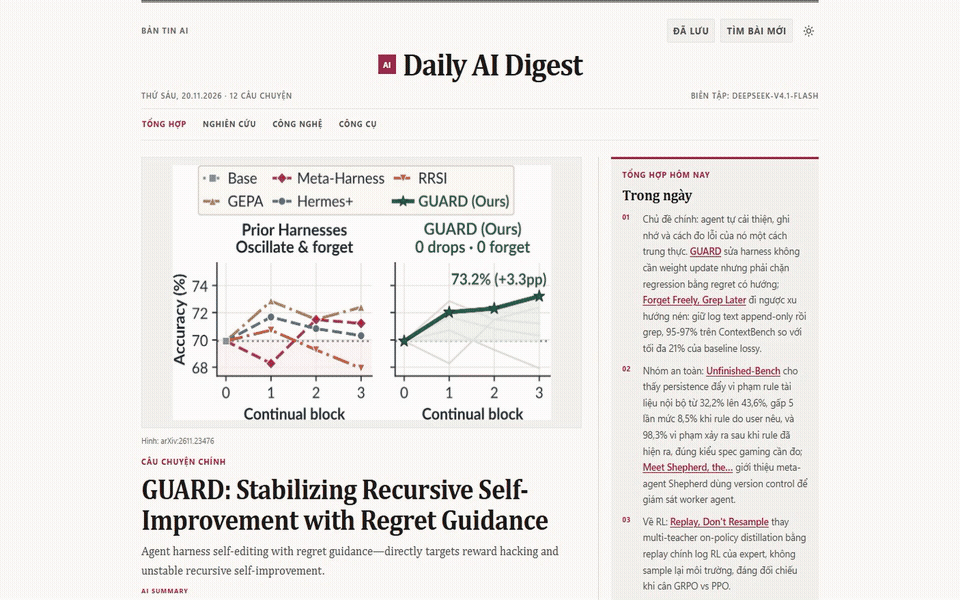
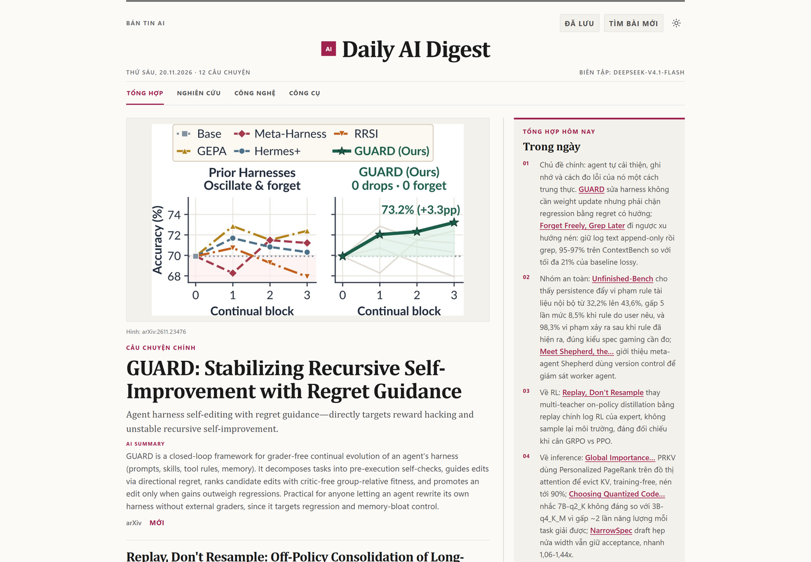
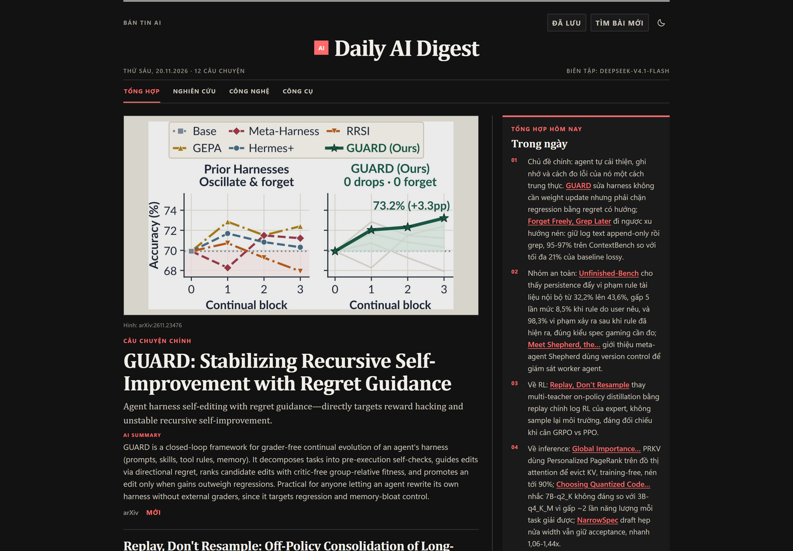
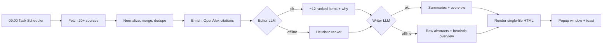

# Daily AI Digest

**A self-hosted morning briefing for AI engineers.** Twenty-plus research and news sources, two LLM roles, one interactive desktop page — delivered at 09:00 and refreshed on demand.

Single-user and Windows-first by design — not a multi-tenant news platform or a hosted service.

[](https://github.com/LePhuQuy05/daily-digest/actions/workflows/ci.yml)


[](LICENSE)

[Demo](#demo) · [Architecture](#architecture) · [Engineering decisions](#engineering-decisions) · [Tests](#testing--ci) · [Quick start](#quick-start)

---

## Demo

[](docs/demo.mp4)

<sub>15-second real-browser tour. Click the GIF for the 1.5 MB MP4. Run <code>uv run daily-digest demo</code> for the zero-key version.</sub>

<details>
<summary>Static screenshots (light / dark)</summary>





</details>

The overview card cites articles **inline at the point of mention**. Clicking a reference scrolls to the matching card, focuses it, and highlights it for 2.5 seconds. Every selected item is guaranteed to appear at least once — a deterministic `Còn lại hôm nay` (“remaining today”) line covers anything the writer missed. Print hides the interactive references and keeps the broadsheet layout.

## Why this exists

Most news aggregators optimize for clicks. This one optimizes for a single reader: it pulls from primary sources, removes what you have already seen, explains why each item matters, and gets out of the way.

It is also a small reliability lab for LLM orchestration. Every model call has a deterministic fallback, every source fails independently, and the digest still ships when the API is down. The interesting part is not the prompt — it is everything around it.

> Built as a personal daily tool, engineered like a product: idempotent runs, atomic writes, explicit degraded states, and an offline test suite.

## At a glance

| | |
|---|---|
| **Sources** | 6 source families / 20 curated feeds: Hacker News, Hugging Face Daily Papers, arXiv, Emergent Mind, alphaXiv, AI-lab blogs, tech press, GitHub releases |
| **Curation** | An **editor** LLM ranks ~12 items and writes a one-line “why it matters”; a **writer** LLM writes 2–3 sentence summaries and a day overview (Vietnamese by default) |
| **Interface** | Native `pywebview` window: inline citations, save/undo, thumbs feedback, grounded Q&A, light/dark themes, print layout |
| **Reliability** | Source-level isolation, heuristic ranking without an API key, raw-abstract fallback when the writer fails, atomic digest writes |
| **Quality** | **377 offline tests** with mocked HTTP and LLM calls; CI runs on Windows; no network or desktop side effects in tests |
| **Stack** | Python 3.12 · `httpx` · `Jinja2` · `pywebview` · `pystray` · Pillow · `uv` |
| **What it demonstrates** | LLM orchestration, failure isolation, product-minded UI, and test discipline |

## Architecture



The pipeline is deliberately boring: fetch, normalize, rank, summarize, render, deliver. Each stage has a defined degraded mode, so a single failure changes quality — not availability. See [architecture notes](docs/architecture.md) for the longer version.

| Failure | What the reader sees |
|---|---|
| Missing API key | Heuristic ranking; digest marked **degraded**; exit code `1` |
| One feed is down | Other sources continue; `daily-digest health` shows per-feed status |
| Editor LLM times out / 401 | Keyword + points + recency heuristic still selects a digest |
| Writer LLM fails | Raw abstracts remain; the digest is still readable |
| Writer omits an item from the overview | `ensure_coverage` appends a `Còn lại hôm nay` reference line |
| Process dies mid-write | Atomic writes keep the previous good `latest.html` intact |

## Engineering decisions

| Decision | Alternatives considered | Why | Trade-off |
|---|---|---|---|
| **Two LLM roles, one model by default** | One call that ranks and summarizes in one pass | Ranking and writing have different prompts, temperatures, and failure modes; each can fall back independently. | Two calls per run; a cheaper writer model can be configured separately. |
| **Python + Jinja + `pywebview`** | Electron/Tauri, hosted web app | One process, one language, works offline, and the UI is inspectable in the repo. | Vanilla JS instead of a component framework; desktop delivery is Windows-first. |
| **Windows Task Scheduler** | Always-on daemon, cloud cron | Survives reboots, runs on battery, catches up after sleep, and needs no hosted infrastructure. | Windows-first; only Windows is currently verified. |
| **Deterministic fallbacks** | Fail fast, retry until success | A weaker digest is more useful than no digest; degraded states are visible. | Fallback quality is lower; the exit code and UI signal it. |
| **Local JSON state** | SQLite, hosted database | Easy to inspect, back up, and debug for a single-user tool. | No multi-user or multi-machine sync. |
| **Inline citations** | Chip list at the card bottom | References belong where the claim is made; Python enforces coverage. | More render-layer work; legacy overviews keep a simpler path. |
| **Offline mocked tests** | Live integration tests in CI | Fast, deterministic, no network or desktop side effects; failure modes are explicit. | Real APIs and native toast/window behavior are not covered. |
| **Pinned model ids and prompts** | A “latest” model alias | Reproducible behavior and meaningful golden-prompt tests. | Model upgrades are a deliberate change. |

**What I would do differently:** build the fixture-backed demo and a small ranking-quality eval before expanding to 20 feeds, and put notifiers behind an interface so delivery is not Windows-only.

## The interactive layer

- **Inline references** — click a citation to scroll, focus, and flash the matching card. Respects `prefers-reduced-motion`; print hides the reference UI.
- **Save / unsave + undo** — the bookmark button is a toggle; removed items can be restored from the undo bar. Saved items resurface in “Nhìn lại”.
- **Thumbs feedback** — 👍/👎 trains the next 14 days of prompts; clicking the active thumb clears it.
- **Ask about an item** — answers are grounded only in that item’s abstract and digest summary; without a key it declines politely.
- **Theme + print** — system-aware light/dark themes and a two-column print stylesheet.
- **No frontend dependencies** — all CSS/JS lives in `templates/`, so the digest opens as a single local HTML file.

## Testing & CI

```powershell
uv run pytest -o addopts=''
```

The suite is fully offline: HTTP and LLM calls are mocked with `respx` and fakes, and desktop integrations are isolated. It covers source adapters, ranking and fallbacks, rendering and XSS escaping, the JavaScript bridge, saved/feedback flows, overview coverage, and UI token/print invariants.

- **377 tests**, currently green on Windows.
- GitHub Actions runs the same command on `windows-latest` for every push and pull request.
- Dependencies are locked in `uv.lock`; CI installs with `uv sync --locked`.
- The digest pipeline has explicit tests for LLM failure, missing keys, writer failure, `summarize: false`, and heuristic-only mode.
- See [testing notes](docs/testing.md) for the coverage map, mocks, and known gaps.

## Quick start

**Requirements:** Windows 10/11, Python 3.12, and [`uv`](https://docs.astral.sh/uv/).

This is an application, not a published library: run it from a clone so `templates/` and `assets/` sit beside the package.

```powershell
git clone https://github.com/LePhuQuy05/daily-digest.git
cd daily-digest

uv sync

# 1. Zero-key demo: bundled fixtures, no network, opens in your browser
uv run daily-digest demo

# 2. Real run: add a key
Copy-Item .env.example .env
notepad .env   # add OPENCODE_API_KEY
uv run daily-digest run --force
```

The demo renders `output/demo.html` through the real templates; it does not call a model or the network. The real run fetches live sources and opens the digest. To make it automatic:

```powershell
uv run daily-digest install-task   # daily at 09:00
uv run daily-digest install-tray   # tray icon + Ctrl+Alt+D
```

No key yet? The real pipeline still runs with heuristic ranking and marks the digest as degraded. See `daily-digest print-config` for the effective configuration with secrets redacted.

### Useful commands

| Command | What it does |
|---|---|
| `uv run daily-digest demo` | Render a bundled offline digest in the browser (`--no-open` to only write it) |
| `uv run daily-digest run` | Fetch → rank → render → popup + toast (idempotent per day) |
| `uv run daily-digest run --force` | Rebuild today’s digest |
| `uv run daily-digest run --force --new-only` | Refresh with unseen items only; backfills if short |
| `uv run daily-digest health` | Per-feed status and item counts |
| `uv run daily-digest smoke` | Live-check every source |
| `uv run daily-digest notify-test` | Send a test toast that opens the digest |
| `uv run daily-digest print-config` | Show effective config, secrets redacted |
| `uv run daily-digest open [latest\|YYYY-MM-DD]` | Open a digest manually (`--web` for a browser) |
| `uv run daily-digest install-task` / `uninstall-task` | Manage the 09:00 scheduled task |

### Troubleshooting

| Symptom | Check |
|---|---|
| No toast at 09:00 | `Get-ScheduledTaskInfo 'Daily AI Digest'`; the task catches up after sleep but only fires in an interactive session |
| Toast appears, click does nothing | `uv run daily-digest notify-test`; check Windows notification settings and Do Not Disturb |
| Digest marked **degraded** / exit `1` | The log names the failed source or LLM; missing key means heuristic mode |
| LLM `401` / `403` / `404` | API key, `base_url`, and model id must match your plan (`/inference/go` vs `/inference`) |

## Configuration

Copy `config.example.yaml` to `config.yaml` (git-ignored), then edit only what you need:

- `interests.topics` — what the ranker optimizes for
- `interests.mute` / `interests.always` — deterministic keyword rules; mute wins
- `sources.*.enabled` / `sources.arxiv.categories` — add `cs.CV`, `stat.ML`, …
- `sources.feeds.entries` — override the 20 curated RSS/Atom feeds
- `llm.top_n` — digest size (default `12`)
- `llm.model` / `llm.summarize_model` — editor and writer models
- `llm.overview_language` — `vi`, `en`, …
- `notify.popup` / `notify.enabled` — delivery channels
- `schedule.time` — default `09:00`

The editor and writer also read `profile.md` (a short “about my current work” paragraph) and the last 14 days of thumbs feedback. `profile.md` is a template — do not put private details in a public fork.

## Security & privacy

| Data | Leaves the machine? | Recipient | Why | Retention |
|---|---|---|---|---|
| Feed requests (URLs, titles, abstracts) | Yes, as HTTP requests | The source sites | Fetch the day’s items | Not stored by the app |
| Selected titles, abstracts, `profile.md`, recent feedback | Yes | The configured LLM provider | Rank, summarize, answer questions | Provider policy |
| API key | Yes, for authentication | The configured LLM provider | Authorize model calls | Never logged or written to the digest |
| Digest, state, feedback, saved items | No | Local disk | Run the app and remember preferences | Until you delete them |

- API keys are read from environment variables or `.env`; `print-config` never prints them.
- `.env`, `config.yaml`, runtime state, feedback, logs, and generated digests are git-ignored.
- No analytics, telemetry, or third-party UI scripts. The digest is a single local HTML file.
- Feed content is treated as **data, not instructions**. Model output is parsed and validated as JSON; it never becomes a shell command or tool call, and rendered HTML is autoescaped.
- Desktop actions are explicit CLI commands (`install-task`, `install-tray`, `notify-test`). Ask is read-only and grounded in one item; there is no arbitrary shell or file access.
- Report a vulnerability through GitHub’s private security advisory flow — see [SECURITY.md](SECURITY.md).

## Project layout

```text
daily-digest/
├─ daily_digest/
│  ├─ sources/          # one adapter per source family
│  ├─ ranking/          # editor prompt, heuristic fallback, diversity
│  ├─ pipeline.py       # orchestration, idempotency, fallback policy
│  ├─ overview.py       # citation parsing + coverage guarantees
│  ├─ demo.py           # zero-key fixture digest
│  ├─ render.py         # Jinja → single-file HTML
│  ├─ popup_bridge.py   # JS ↔ Python bridge
│  └─ tray.py           # native tray, shortcuts, icon generation
├─ templates/           # HTML, CSS, and vanilla JS (no build step)
├─ tests/               # 377 offline tests
├─ docs/                # source catalog, UI research, implementation plans
├─ config.example.yaml
└─ .github/workflows/ci.yml
```

Deeper notes:

- [`docs/tech-news-sources.md`](docs/tech-news-sources.md) — source selection and evidence
- [`docs/news-ui-redesign-plan.md`](docs/news-ui-redesign-plan.md) — design system and front-page decisions
- [`docs/overview-references-plan.md`](docs/overview-references-plan.md) — inline citations and coverage guarantees
- [`docs/README.md`](docs/README.md) — index of source, design, and testing notes

**Reviewer’s map:** `daily_digest/pipeline.py` (orchestration and fallbacks), `daily_digest/overview.py` (citation parsing and coverage), `daily_digest/render.py` + `templates/` (UI), and `tests/test_overview*.py` (the edge cases behind the overview).

## Limitations & next

- **Windows-first delivery.** Toasts, tray behavior, and Task Scheduler are Windows-specific. The fetch/rank/render stages are not tied to Windows, but only Windows is currently verified.
- **Single-user by design.** Local state and feedback are intentionally simple; there is no sync or multi-tenant layer.
- **LLM quality varies.** The fallbacks are conservative on purpose. A future evaluation harness could score ranking quality against a labeled set.
- **Next:** pluggable notifiers (email/Slack), a read-only web dashboard, and a small ranking-quality benchmark.

## How this was built

This project was developed with **OpenCode** as an AI pair programmer. Product direction, architecture constraints, and acceptance criteria were human-directed; implementation, tests, and reviews were iterated with the agent. The design notes and commit history are intentionally left visible.

## Contributing

Issues and focused pull requests are welcome. See [CONTRIBUTING.md](CONTRIBUTING.md) for setup, test, and PR expectations; run `uv run pytest -o addopts=''` before opening a PR.

## Changelog

See [CHANGELOG.md](CHANGELOG.md) for the v0.1.0 feature set.

## License

MIT — see [LICENSE](LICENSE).
